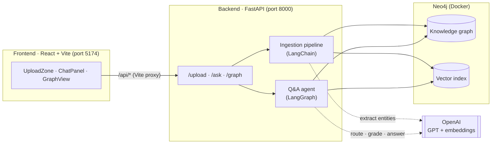
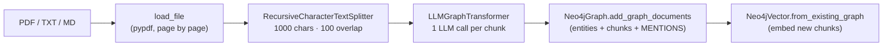
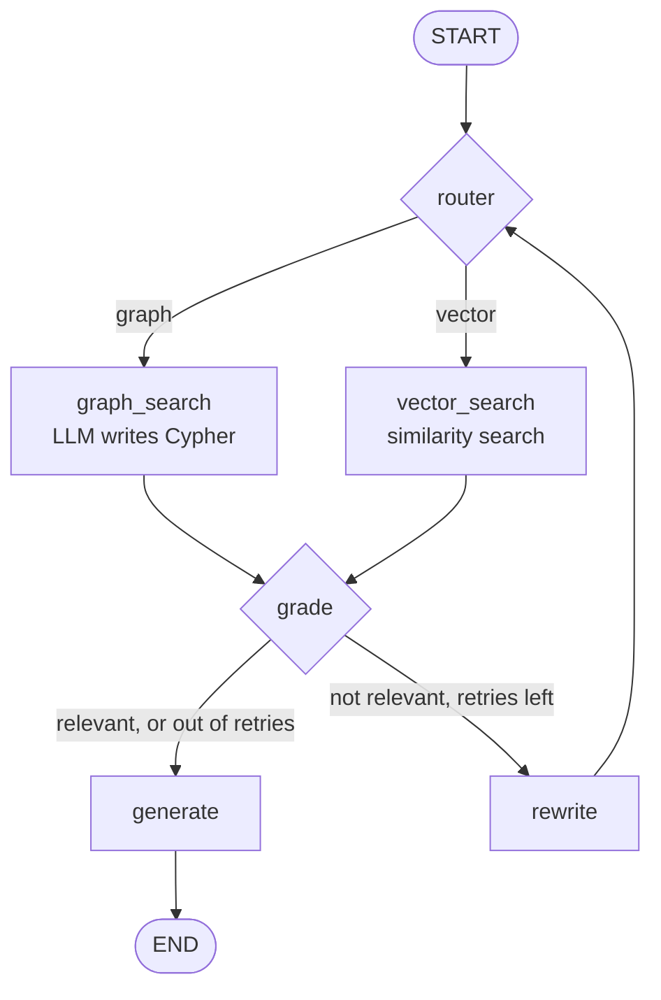

<div align="center">

# ✦ StudyGraph

### A GraphRAG study assistant: turn your notes into a knowledge graph and chat with them


</div>

---

## Table of contents

- [Overview](#overview)
- [Features](#features)
- [Architecture](#architecture)
- [Tech stack](#tech-stack)
- [Project structure](#project-structure)
- [Getting started](#getting-started)
- [Configuration](#configuration)
- [Usage](#usage)
- [API reference](#api-reference)
- [How it works](#how-it-works)
- [Data model](#data-model)
- [Design decisions](#design-decisions)
- [Testing](#testing)
- [Troubleshooting](#troubleshooting)
- [Security notes](#security-notes)
- [Roadmap](#roadmap)

---

## Overview

**StudyGraph** is a full-stack, AI-powered study tool built on **GraphRAG** (graph-based retrieval-augmented
generation). Upload your study notes as PDF, text or Markdown files, and StudyGraph will:

1. **Extract** the concepts and the relationships between them with an LLM, and build a **knowledge graph** in Neo4j.
2. **Embed** the original text chunks as vectors and store them **in the same Neo4j database**.
3. **Answer your questions** with an AI agent that chooses the best search strategy for each question.
4. **Visualise** your knowledge as an interactive, animated constellation.

Standard RAG finds text that *looks similar* to a question. GraphRAG can also follow **connections between
concepts**, so it can answer multi-step questions such as *"How is chlorophyll connected to glucose
production?"*, where the answer is spread across several facts.

## Features

| | Feature | Description |
|---|---|---|
| 🧠 | **Notes → knowledge graph** | An LLM extracts entities and relationships from each chunk of text. |
| 🔀 | **Hybrid retrieval** | Relationship questions use **graph search** (the LLM writes Cypher); descriptive questions use **vector search**. |
| 🔁 | **Self-correcting agent** | A LangGraph agent grades the retrieved context and rephrases the question when the result isn't good enough. |
| 🌌 | **Constellation UI** | The graph is drawn as a star map. Concepts mentioned in an answer light up, and clicking a star shows its connections. |
| 🔍 | **Transparent answers** | Each answer shows which search was used, whether the question was rephrased, and its sources (file and page, or the Cypher query). |
| 🗄️ | **One database** | Neo4j stores both the knowledge graph and the vector index. |

## Architecture



## Tech stack

**Backend**

| Technology | Role |
|---|---|
| [FastAPI](https://fastapi.tiangolo.com/) + Uvicorn | REST API and ASGI server |
| [LangChain](https://python.langchain.com/) | Text splitting and LLM orchestration |
| [LangGraph](https://langchain-ai.github.io/langgraph/) | Stateful, multi-step question-answering agent |
| [langchain-neo4j](https://pypi.org/project/langchain-neo4j/) | `LLMGraphTransformer`, `Neo4jGraph`, `Neo4jVector`, `GraphCypherQAChain` |
| [Neo4j](https://neo4j.com/) (Docker, Community edition) | Graph database and vector index, with the APOC plugin |
| OpenAI | `gpt-5.4-mini` (chat) and `text-embedding-3-small` (embeddings), both configurable |
| pypdf | PDF text extraction |
| Pydantic / pydantic-settings | Validation and `.env` configuration |
| [uv](https://docs.astral.sh/uv/) | Dependency and environment management |

**Frontend**

| Technology | Role |
|---|---|
| React 19 + Vite | UI framework and dev server / bundler |
| [react-force-graph-2d](https://github.com/vasturiano/react-force-graph) | Canvas-based, physics-driven graph rendering |
| Axios | HTTP client |
| Plain CSS | Custom night-sky theme |

## Project structure

```
GraphRAG/
├── backend/                        # Python · FastAPI · LangChain · LangGraph
│   ├── app/
│   │   ├── main.py                 # App entry: routers, CORS, 503 handler, /health
│   │   ├── config.py               # Settings loaded from backend/.env
│   │   ├── api/routes/
│   │   │   ├── upload.py           # POST /upload
│   │   │   ├── ask.py              # POST /ask
│   │   │   └── graph.py            # GET  /graph
│   │   ├── schemas/models.py       # Request and response models
│   │   ├── services/               # LangChain layer
│   │   │   ├── llm.py              # ChatOpenAI and OpenAIEmbeddings
│   │   │   ├── ingestion.py        # File → chunks → graph + embeddings
│   │   │   ├── graph_store.py      # Neo4j connection, Cypher chain, graph data
│   │   │   └── vector_store.py     # Vector index and similarity search
│   │   └── agent/                  # LangGraph layer
│   │       ├── state.py            # Shared agent state
│   │       ├── nodes.py            # One function per agent step
│   │       └── graph.py            # Workflow wiring (StateGraph)
│   ├── tests/                      # Offline tests (no OpenAI / Neo4j needed)
│   ├── docker-compose.yml          # Neo4j container
│   ├── pyproject.toml / uv.lock    # uv project
│   └── requirements.txt            # Pinned dependencies for pip
│
└── frontend/                       # React · Vite
    ├── src/
    │   ├── main.jsx                # React entry point
    │   ├── App.jsx                 # Layout and shared state; highlights stars named in answers
    │   ├── api.js                  # Axios client for /upload, /ask, /graph
    │   ├── colors.js               # Consistent colour per entity type
    │   ├── styles.css              # Night-sky theme
    │   └── components/
    │       ├── UploadZone.jsx      # Drag-and-drop upload
    │       ├── ChatPanel.jsx       # Chat with route badges and sources
    │       └── GraphView.jsx       # Interactive constellation graph
    └── vite.config.js              # Dev server (5174) and /api proxy → 8000
```

## Getting started

### Prerequisites

- **Python** 3.12+ and **[uv](https://docs.astral.sh/uv/)**
- **Node.js** 20+
- **[Docker Desktop](https://www.docker.com/products/docker-desktop/)**
- An **[OpenAI API key](https://platform.openai.com/api-keys)**

### 1. Clone the repository

```bash
git clone <your-repo-url> GraphRAG
cd GraphRAG
```

### 2. Configure the backend

```bash
cd backend
cp .env.example .env
```

Open `backend/.env` and set at least `OPENAI_API_KEY` and `NEO4J_PASSWORD` (see [Configuration](#configuration)).

### 3. Start Neo4j

From the `backend/` folder:

```bash
docker compose up -d
```

Neo4j Browser is available at **http://localhost:7474**. Log in as `neo4j` with your `NEO4J_PASSWORD`.

### 4. Start the backend

```bash
uv sync
uv run uvicorn app.main:app --reload
```

- API: **http://localhost:8000**
- Interactive docs (Swagger): **http://localhost:8000/docs**

> **Without uv:** `pip install -r requirements.txt`, then `uvicorn app.main:app --reload`.

### 5. Start the frontend

In a second terminal:

```bash
cd frontend
npm install
npm run dev
```

Open **http://localhost:5174**.

### Services at a glance

| Service | Command | URL |
|---|---|---|
| Neo4j | `docker compose up -d` (in `backend/`) | http://localhost:7474 (browser), `bolt://localhost:7687` |
| Backend | `uv run uvicorn app.main:app --reload` | http://localhost:8000 |
| Frontend | `npm run dev` (in `frontend/`) | http://localhost:5174 |

## Configuration

All backend settings are read from `backend/.env`.

| Variable | Description | Default |
|---|---|---|
| `OPENAI_API_KEY` | OpenAI API key | **required** |
| `NEO4J_PASSWORD` | Neo4j password (8+ characters; also used by `docker-compose.yml`) | **required** |
| `LLM_MODEL` | Chat model for extraction, routing, grading and answers | `gpt-5.4-mini` |
| `EMBEDDING_MODEL` | Embedding model for vector search | `text-embedding-3-small` |
| `NEO4J_URI` | Neo4j Bolt URL | `bolt://localhost:7687` |
| `NEO4J_USERNAME` | Neo4j user | `neo4j` |
| `CHUNK_SIZE` | Characters per text chunk | `1000` |
| `CHUNK_OVERLAP` | Overlap between chunks | `100` |
| `MAX_RETRIES` | Times the agent may rephrase a question | `2` |
| `VECTOR_TOP_K` | Chunks returned by vector search | `4` |

> If you change `EMBEDDING_MODEL` after uploading files, the existing vector index will have a different
> size. Clear the database (or drop the `document_embeddings` index) before uploading again.

## Usage

1. **Upload notes.** Drag a `.pdf`, `.txt` or `.md` file onto **Add notes**. The graph is built with one LLM
   call per chunk, so larger files take longer. You'll see a summary such as *"42 stars, 67 links from 14 chunks"*.
2. **Explore the graph.** Bigger stars have more connections. Click a star to see its type and every
   relationship it has. Use **Fit** to recentre the view.
3. **Ask questions.**

   | Example question | Expected route |
   |---|---|
   | *"What is photosynthesis?"* | 📄 Note search (vector) |
   | *"How is chlorophyll connected to glucose?"* | 🔗 Graph search (Cypher) |

   Concepts mentioned in the answer light up in the graph.

## API reference

Base URL: `http://localhost:8000`. Full interactive docs are at `/docs`.

| Method | Endpoint | Description |
|---|---|---|
| `GET` | `/health` | Liveness check |
| `POST` | `/upload` | Upload a file and build the graph |
| `POST` | `/ask` | Ask a question |
| `GET` | `/graph?limit=300` | Entity nodes and edges for visualisation (`limit`: 1–2000) |

<details>
<summary><b>POST /upload</b></summary>

`multipart/form-data` with a `file` field (`.pdf`, `.txt` or `.md`).

```bash
curl -F "file=@notes.pdf" http://localhost:8000/upload
```

```json
{ "filename": "notes.pdf", "chunks": 14, "nodes": 42, "relationships": 67 }
```

</details>

<details>
<summary><b>POST /ask</b></summary>

```bash
curl -X POST http://localhost:8000/ask \
  -H "Content-Type: application/json" \
  -d '{"question": "How is chlorophyll connected to glucose?"}'
```

```json
{
  "answer": "Chlorophyll absorbs light energy, which is converted to ATP. The Calvin cycle uses ATP to produce glucose.",
  "route": "graph",
  "sources": ["Cypher: MATCH (c {id: 'Chlorophyll'})-[*1..3]-(g {id: 'Glucose'}) RETURN ..."],
  "retries": 0
}
```

</details>

<details>
<summary><b>GET /graph</b></summary>

```json
{
  "nodes": [{ "id": "Chlorophyll", "type": "Molecule" }],
  "edges": [{ "source": "Chlorophyll", "target": "Light Energy", "relation": "ABSORBS" }]
}
```

</details>

**Errors:** `400` for an unsupported or empty file, `422` for an invalid request, and `503` when Neo4j is unreachable.

## How it works

### 1. Ingestion pipeline (LangChain)



1. **Load:** PDFs are read page by page, keeping the file name and page number. Text and Markdown files are read whole.
2. **Split:** the text is cut into overlapping chunks, and empty chunks are dropped.
3. **Extract:** `LLMGraphTransformer` turns each chunk into entities (nodes) and relationships (edges).
4. **Store:** entities are written with an extra `__Entity__` label, and each one is linked to the chunk it came
   from with a `MENTIONS` relationship.
5. **Embed:** any chunk without an embedding is embedded and added to the `document_embeddings` vector index.

### 2. Question-answering agent (LangGraph)



| Node | Responsibility |
|---|---|
| `router` | The LLM classifies the question as **graph** (relationships) or **vector** (definitions and explanations). |
| `graph_search` | `GraphCypherQAChain` writes a Cypher query and runs it. Invalid Cypher counts as "nothing found". |
| `vector_search` | Finds the most similar chunks and keeps their file and page as sources. |
| `grade` | The LLM checks whether the context can answer the question. Empty context fails without an LLM call. |
| `rewrite` | The LLM rephrases the question and the retry counter goes up. |
| `generate` | The LLM writes the final answer from the context only, and says so when the notes don't contain it. |

All nodes share one **`AgentState`**: `question`, `search_query`, `route`, `context`, `sources`, `is_relevant`,
`retries` and `answer`. The original `question` never changes; `search_query` is what gets rephrased.

### 3. Frontend

- **`App.jsx`** loads the graph, converts `{nodes, edges}` to the `{nodes, links}` format the graph library
  expects, works out each node's number of connections (used for its size), and highlights nodes named in each answer.
- **`GraphView.jsx`** draws every node as a glowing star on a canvas. Highlighted and selected stars glow white,
  their links carry moving particles, and the view auto-fits once the layout settles.
- **`ChatPanel.jsx`** shows the route badge, the rephrase count and collapsible sources for every answer.
- **`api.js`** sends all requests to `/api`, which Vite forwards to the backend, and turns FastAPI errors into
  readable messages.

## Data model

```
(:Document {id, text, source, page, embedding})        ← text chunk + vector
        │
        │ :MENTIONS
        ▼
(:__Entity__:<Type> {id})  ──[:<RELATION>]──►  (:__Entity__:<Type> {id})
     e.g. :Molecule "Chlorophyll"  ──[:ABSORBS]──►  :Concept "Light Energy"
```

- **Vector search** queries `Document` nodes by embedding similarity.
- **Graph search** queries `__Entity__` nodes and their relationships with Cypher.
- `Document` nodes and `MENTIONS` links are **hidden** from both the Cypher-writing LLM and `GET /graph`, so
  both work with the concept graph only.

Example queries for Neo4j Browser:

```cypher
// Whole concept graph
MATCH (a:__Entity__)-[r]->(b:__Entity__) RETURN a, r, b LIMIT 100;

// Which chunks mention a concept
MATCH (d:Document)-[:MENTIONS]->(e:__Entity__ {id: "Chlorophyll"}) RETURN d.source, d.page, d.text;
```

## Design decisions

| Decision | Rationale |
|---|---|
| **Neo4j for both graph and vectors** | One database to run and keep in sync; chunks are linked directly to the entities they mention. |
| **LangGraph for the agent** | Routing, grading and retry loops with shared state stay explicit and easy to test. |
| **Two search methods** | Relationship questions need graph traversal; definition questions need semantic text search. |
| **Cypher chain rebuilt on every question** | The chain captures the graph schema when it is created, and the schema changes after each upload. |
| **Database rows returned directly from Cypher** | `return_direct=True` skips the chain's own answer step; the agent writes one final answer instead. |
| **Cached clients (`lru_cache`)** | Avoids reconnecting to Neo4j or recreating OpenAI clients on every request. |
| **Vite proxy for `/api`** | The browser talks to a single origin, so CORS isn't needed during development. |
| **Star size by number of connections** | Central concepts stand out at a glance. |

## Testing

```bash
cd backend
uv run pytest
```

The tests run **offline**, with no OpenAI key or Neo4j needed. They cover the health check, upload
validation, request validation, agent wiring and the retry logic.

## Troubleshooting

| Symptom | Cause and fix |
|---|---|
| `503: Neo4j is unavailable` | Docker isn't running. Start Docker Desktop and run `docker compose up -d` in `backend/`. |
| *"The backend isn't responding"* in the UI | Start the backend on port 8000. |
| `401` / authentication errors from OpenAI | Check `OPENAI_API_KEY` in `backend/.env`. |
| APOC procedure errors | The Docker setup includes APOC. With your own Neo4j, install the APOC plugin. |
| Vector index dimension mismatch | `EMBEDDING_MODEL` changed after upload. See the note in [Configuration](#configuration). |
| Port 5174 already in use | Stop the other process, or change `server.port` in `frontend/vite.config.js` (and `cors_origins` in `backend/app/config.py`). |
| `uv: command not found` (Windows) | Run `python -m uv ...`, or add Python's `Scripts` folder to your `PATH`. |

## Security notes

- `GraphCypherQAChain` executes **LLM-generated Cypher**. For anything beyond local use, connect with a
  **read-only Neo4j user**.
- Never commit `backend/.env`. It is git-ignored.
- Uploaded files are stored in `backend/data/uploads/` (git-ignored).

## Roadmap

- [ ] Conversation memory across questions (LangGraph checkpointer)
- [ ] A combined route that merges graph and vector results
- [ ] Entity resolution (merge duplicates such as "Elon" and "Elon Musk")
- [ ] Streaming answers
- [ ] Faster ingestion by extracting chunks in parallel
- [ ] Delete and re-upload individual documents
